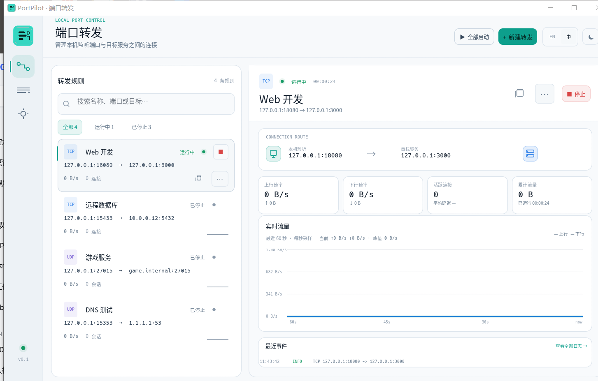
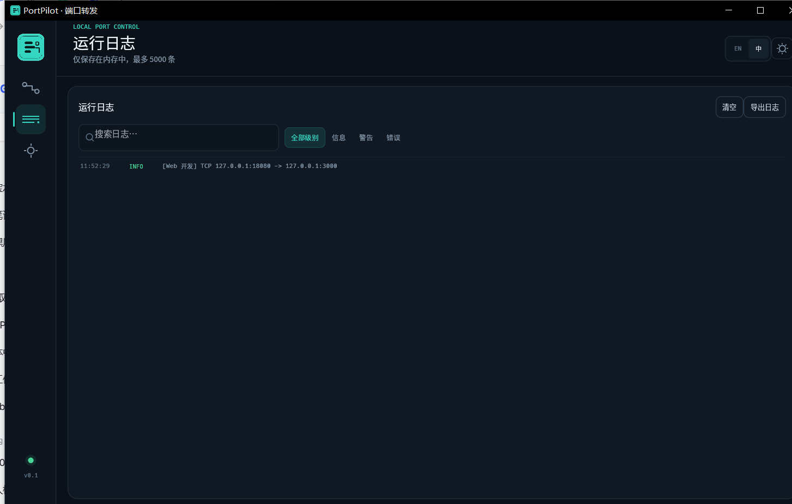
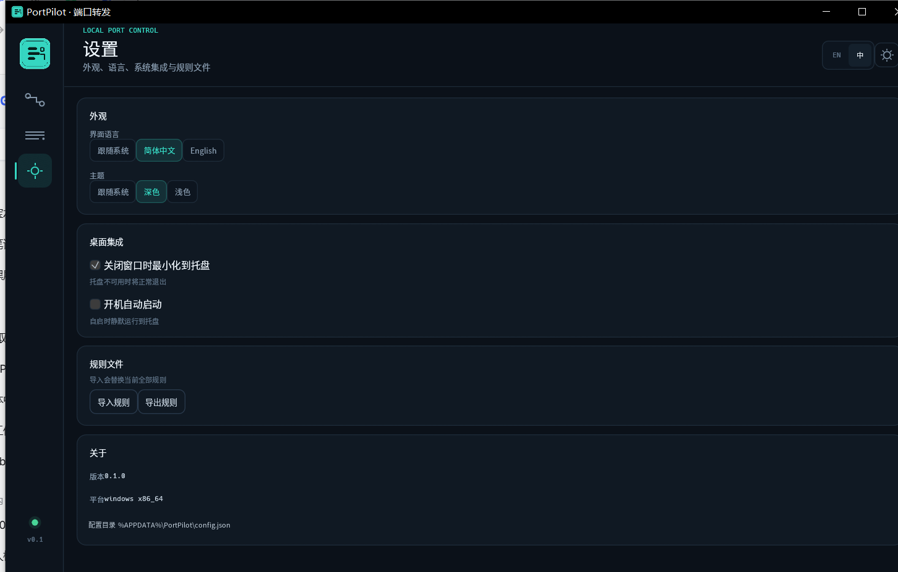
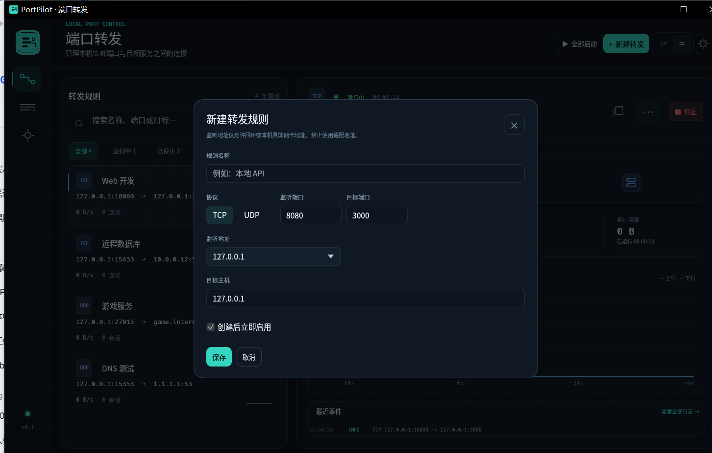
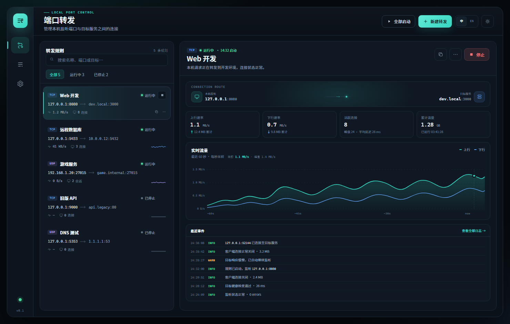

# PortPilot

PortPilot 是一个使用 Rust 和 egui 构建的跨平台本地端口转发桌面工具。它在指定网卡上监听 TCP 或 UDP 端口，并把流量转发到目标主机。



## 功能

- 多条 TCP / UDP 转发规则，支持 IPv4、IPv6 和域名目标。
- 监听地址严格限制为回环地址或本机具体网卡地址，不允许通配地址。
- 规则级启动、停止、重启、编辑、复制和删除。
- 实时字节数、速率、活跃连接和平均连接延迟统计。
- 最近 60 秒流量曲线，速率单位自动进位。
- 内存日志与导出，最多保留 5000 条。
- 中文 / English 双语界面，跟随系统、深色和浅色主题。
- 关闭到托盘、系统托盘全部启动 / 停止、开机自启。
- 单实例运行；再次启动会唤醒已有窗口。
- 规则 JSON 导入 / 导出和配置持久化。

## 截图

| 运行日志 | 设置 |
| --- | --- |
|  |  |

| 新建规则 | 设计预览 |
| --- | --- |
|  |  |

## 使用

1. 打开 PortPilot，点击“新建转发”。
2. 选择 TCP 或 UDP，填写监听地址、监听端口、目标主机和目标端口。
3. 保存并启动规则。
4. 通过 `监听地址:监听端口` 访问目标服务。

键盘快捷键：

- `Ctrl+1`：转发规则
- `Ctrl+2`：运行日志
- `Ctrl+3`：设置
- `Ctrl+N`：新建规则
- `Ctrl+Shift+T`：切换深色 / 浅色主题

配置与规则默认保存在：

- Windows：`%APPDATA%\PortPilot\config.json`
- macOS：`~/Library/Application Support/PortPilot/config.json`
- Linux：`$XDG_CONFIG_HOME/PortPilot/config.json`，通常为 `~/.config/PortPilot/config.json`

## 构建

需要 Rust stable。Windows 可使用 MSVC 工具链，或使用带现代 MinGW-w64 的 GNU 工具链。

```powershell
cargo run
cargo test
cargo build --release
```

Release 产物：

- Windows：`target/release/portpilot.exe`
- macOS / Linux：`target/release/portpilot`

当前 Windows 便携版已复制到 `dist/portpilot-0.1.0-windows-x64.exe`，同目录包含 SHA-256 校验文件。

Windows GNU 工具链需要 `x86_64-w64-mingw32-gcc`、`windres`、`ar` 和 `dlltool` 在 `PATH` 中。应用构建不依赖 Visual Studio IDE。

Linux 构建还需要 GTK3、AppIndicator、X11 和 Wayland 开发包，例如：

```bash
sudo apt install libgtk-3-dev libayatana-appindicator3-dev \
  libxkbcommon-dev libwayland-dev libx11-xcb-dev \
  libxcb-render0-dev libxcb-shape0-dev libxcb-xfixes0-dev
```

仓库包含 `.github/workflows/build.yml`，可在 GitHub Actions 上构建 Windows、macOS 和 Linux 产物，无需在本机安装 Visual Studio。

发布新版本时，确保 `Cargo.toml` 版本与标签一致，然后推送版本标签：

```bash
git tag v0.1.0
git push origin v0.1.0
```

标签构建成功后会由 GitHub Actions 自动创建对应的 GitHub Release，并上传三平台压缩包和 SHA-256 校验文件。

## 测试

```powershell
cargo fmt --all -- --check
cargo clippy --all-targets -- -D warnings
cargo test --all-targets
```

- 单元测试覆盖规则校验、配置读写、日志容量、地址和单位格式化。
- 集成测试在本机随机端口创建 TCP / UDP echo 服务，验证双向转发、流量统计和监听冲突错误。
- 当前 Windows 构建已完成实机启动、TCP 流量转发和单实例验证。

## 限制

- 当前只支持本机监听转发到目标，不包含反向转发、SSH 隧道、HTTP/SOCKS 代理。
- UDP 支持普通单播，不支持组播和广播。
- TCP 目标连接超时为 10 秒；UDP 会话空闲 60 秒回收；单规则上限 1024 个连接或会话。
- 端口小于 1024 时，部分系统可能需要额外权限。
- 发布产物未签名，Windows 可能显示安全警告。
- macOS 和 Linux 当前只保证源码可构建和 CI 编译，托盘、开机自启和 GUI 仍需对应平台实机验证。

第三方字体：Noto Sans SC，许可证见 `assets/fonts/OFL.txt`。

